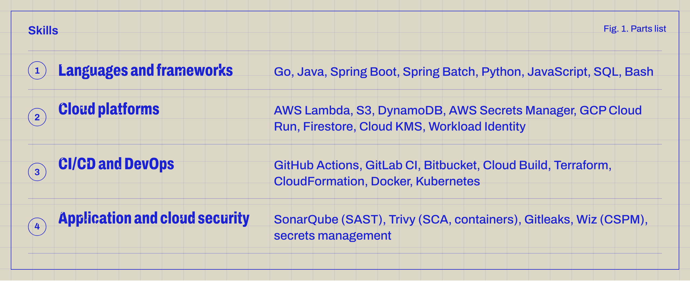
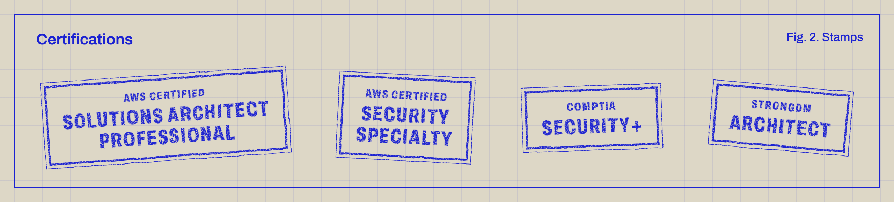
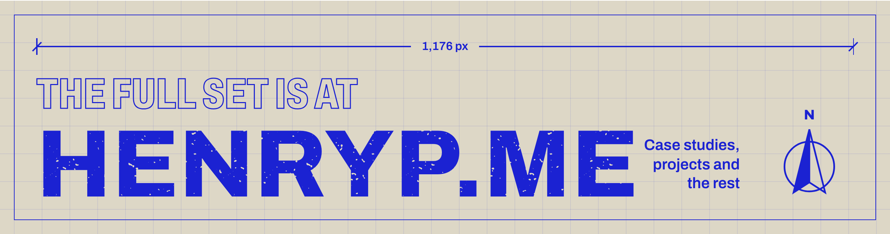

<a href="https://henryp.me">
  <picture>
    <source media="(prefers-color-scheme: dark)" srcset="assets/banner-blueprint.png">
    
  </picture>
</a>

I build security into how software gets delivered: CI/CD platforms, secrets management, IAM and infrastructure as code on AWS and GCP. I write Go, Python, Java and Terraform, and I'm currently a Solutions Consultant at Wiz, now part of Google.

<picture>
  <source media="(prefers-color-scheme: dark)" srcset="assets/light-blueprint.svg">
  
</picture>

<picture>
  <source media="(prefers-color-scheme: dark)" srcset="assets/skills-blueprint.png">
  
</picture>

<picture>
  <source media="(prefers-color-scheme: dark)" srcset="assets/certs-blueprint.png">
  
</picture>

<a href="https://henryp.me">
  <picture>
    <source media="(prefers-color-scheme: dark)" srcset="assets/link-blueprint.png">
    
  </picture>
</a>

The full set of drawings is at [henryp.me](https://henryp.me). I'm also on [LinkedIn](https://www.linkedin.com/in/henryjphillips/).
