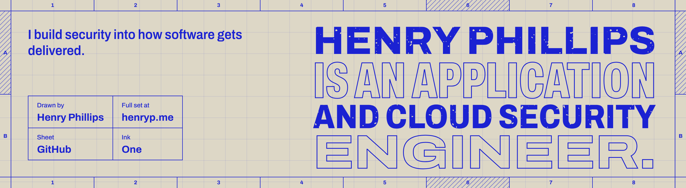

<a href="https://henryp.me">
  <picture>
    <source media="(prefers-color-scheme: dark)" srcset="assets/banner-blueprint.png">
    
  </picture>
</a>

I build security into how software gets delivered: CI/CD platforms, secrets management, IAM and infrastructure as code on AWS and GCP. I write Go, Python, Java and Terraform, and I'm currently a Solutions Consultant at Wiz, now part of Google.

<picture>
  <source media="(prefers-color-scheme: dark)" srcset="assets/light-blueprint.svg">
  
</picture>

## Skills

| No. | Group | Tools |
| :-: | :-- | :-- |
| 1 | **Languages and frameworks** | Go, Java, Spring Boot, Spring Batch, Python, JavaScript, SQL, Bash |
| 2 | **Cloud platforms** | AWS Lambda, S3, DynamoDB, AWS Secrets Manager, GCP Cloud Run, Firestore, Cloud KMS, Workload Identity |
| 3 | **CI/CD and DevOps** | GitHub Actions, GitLab CI, Bitbucket, Cloud Build, Terraform, CloudFormation, Docker, Kubernetes |
| 4 | **Application and cloud security** | SonarQube (SAST), Trivy (SCA, containers), Gitleaks, Wiz (CSPM), secrets management |

## Certifications

| Issued by | Certification |
| :-- | :-- |
| AWS | **Solutions Architect - Professional** |
| AWS | **Security - Specialty** |
| CompTIA | **Security+** |
| StrongDM | **Architect** |

## General notes

1. The full set of drawings is at [henryp.me](https://henryp.me): case studies, projects and the rest.
2. Built to code: Go, Python, Java and Terraform.
3. Drawn in one ink and set in one typeface.
4. Also on [LinkedIn](https://www.linkedin.com/in/henryjphillips/).
